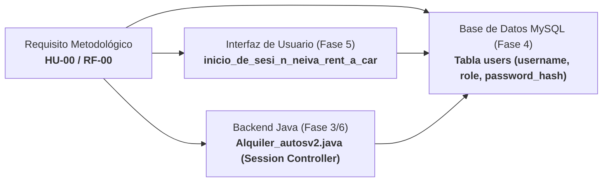

# Especificación de Requerimientos: Módulo de Autenticación y Control de Acceso (HU-00 / RF-00)
## Sistema de Gestión de Alquiler de Vehículos — Neiva Rent a Car

**Programa de Formación:** Tecnólogo en Análisis y Desarrollo de Software (ADSO) — SENA  
**Ficha:** 3239188 | **Sede:** Centro de la Industria, la Empresa y los Servicios (CIES) — Regional Huila  
**Instructor Evaluador:** Carlos Julio Cadena  
**Grupo:** Grupo 06  
**Integrantes:** Gabriel Tijaro Jiménez, Camilo Gaitán  
**Fecha:** Noviembre de 2026  
**Artefactos Relacionados:**
* Prototipo de Login: `Fase 5-Mockup/rent a car/inicio_de_sesi_n_neiva_rent_a_car/code.html`
* Tabla de Persistencia: `users` en `Fase 4/vehicle_rental.sql`
* Especificación de Requerimientos: `REQUERIMIENTOS DEL SISTEMA.pdf` (Sección 2.3 y RNF-05)

---

## 1. Justificación y Propósito del Módulo

En la evaluación de la arquitectura y prototipado del sistema, se evidenció la existencia de la tabla relacional `users` y la pantalla de acceso corporativo `inicio_de_sesi_n_neiva_rent_a_car`. Sin embargo, metodológicamente el inicio de sesión se encontraba catalogado únicamente de forma tangencial como un requerimiento no funcional de seguridad (`RNF-05`).

Para subsanar formalmente el vacío metodológico del **"Login Huérfano"** y garantizar una **trazabilidad 1 a 1**, este documento formaliza la historia de usuario **`HU-00`** y el requerimiento funcional **`RF-00`**, estableciendo las reglas de negocio, flujos de excepción y la matriz de Control de Acceso Basado en Roles (**RBAC**).

---

## 2. Historia de Usuario: HU-00 (Iniciar Sesión en el Sistema)

| Código | HU-00 | Prioridad MoSCoW | Must Have (Obligatorio) |
| :--- | :--- | :--- | :--- |
| **Nombre** | **Iniciar Sesión en el Sistema** | **Iteración** | Fase 5 / Fase 6 |
| **Rol (Actor)** | Operador del Sistema (*Administrador, Empleado, Cajero*) | | |

### Descripción Narrativa:
> **COMO** operador autorizado de Neiva Rent a Car (*Administrador, Empleado o Cajero*),  
> **QUIERO** autenticarme en la plataforma mediante mi nombre de usuario y contraseña personal,  
> **PARA** acceder a las funcionalidades correspondientes a mi cargo y registrar operaciones con auditoría de mi rol.

---

### Criterios de Aceptación (Formato Gherkin - Dado / Cuando / Entonces):

#### Escenario 1: Autenticación exitosa y apertura de sesión operativa
* **Dado** que el operador se encuentra en la pantalla de inicio de sesión (`inicio_de_sesi_n_neiva_rent_a_car`),
* **Y** el operador ingresa un nombre de usuario registrado en la base de datos (ej. `lmendez`) y su contraseña correcta,
* **Cuando** presiona el botón *"Iniciar sesión"*,
* **Entonces** el sistema valida el hash criptográfico contra la tabla `users`,
* **Y** establece la sesión con el rol correspondiente (`ADMIN`, `EMPLOYEE` o `CASHIER`),
* **Y** redirige al operador al Panel de Control Operativo (`panel_de_control_resumen_operativo`), mostrando un saludo personalizado con su nombre y cargo.

#### Escenario 2: Credenciales inválidas (Seguridad y Prevención de Enumeración)
* **Dado** que el usuario ingresa un nombre de usuario inexistente o una contraseña incorrecta,
* **Cuando** presiona el botón *"Iniciar sesión"*,
* **Entonces** el sistema deniega el acceso,
* **Y** muestra un mensaje de retroalimentación semánticamente coherente:  
  `"Error de autenticación: Usuario o contraseña incorrectos."`  
  *(Sin revelar si el fallo estuvo en el usuario o en la clave, previniendo ataques de enumeración).*

#### Escenario 3: Validación de campos vacíos en tiempo real (Client-side feedback)
* **Dado** que el usuario intenta presionar *"Iniciar sesión"* dejando el campo de usuario o de contraseña vacío,
* **Cuando** el foco sale del campo o se envía el formulario,
* **Entonces** el navegador resalta el campo con advertencia nativa de campo requerido antes de disparar peticiones al servidor.

#### Escenario 4: Cierre de sesión seguro (Logout)
* **Dado** que un operador con sesión activa presiona el botón de salida (`logout`) en la cabecera superior,
* **Cuando** confirma el cierre,
* **Entonces** el sistema invalida la sesión activa y redirige inmediatamente a la pantalla de login.

---

## 3. Requerimiento Funcional: RF-00 (Autenticación y Control de Acceso por Roles)

### 3.1. Especificación Técnica
* **Entradas:** `username` (`VARCHAR(50)`), `password` (Texto plano enviado por canal seguro HTTPS).
* **Procesamiento:**
  1. Normalización del nombre de usuario (remoción de espacios y conversión a minúsculas).
  2. Búsqueda del registro en la tabla `users` mediante `WHERE username = ?`.
  3. Verificación de hash utilizando algoritmo seguro (`bcrypt` con costo $\ge 10$ o `Argon2id`).
  4. Carga del identificador de usuario (`user_id`), nombre completo (`full_name`) y rol (`role`).
* **Salidas:** Token de sesión seguro (JWT / Cookie `HttpOnly`) y redirección a vista autorizada.
* **Excepciones:** Bloqueo temporal por tasa de intentos fallidos (prevención de fuerza bruta).

---

### 3.2. Matriz de Control de Acceso Basado en Roles (RBAC)

El sistema contempla 3 perfiles operativos diferenciados según la estructura corporativa de Neiva Rent a Car:

| Módulo / Funcionalidad | Código Requisito | Administrador (`ADMIN`) | Empleado (`EMPLOYEE`) | Cajero (`CASHIER`) |
| :--- | :---: | :---: | :---: | :---: |
| **Autenticación y Logout** | `RF-00` | ✔ Permitido | ✔ Permitido | ✔ Permitido |
| **Registrar Vehículo Nuevo** | `RF-01 / HU-01` | ✔ Permitido | ❌ Restringido | ❌ Restringido |
| **Editar Datos de Vehículo** | `RF-01 / HU-01` | ✔ Permitido | ❌ Restringido | ❌ Restringido |
| **Dar de Baja Vehículo (`INACTIVE`)**| `RF-01 / HU-03` | ✔ Permitido | ❌ Restringido | ❌ Restringido |
| **Consultar Catálogo de Flota** | `RF-02 / HU-02` | ✔ Permitido | ✔ Permitido | ✔ Solo lectura |
| **Registrar / Editar Clientes** | `RF-03 / HU-04, HU-05` | ✔ Permitido | ✔ Permitido | ❌ Restringido |
| **Apertura de Contrato de Alquiler**| `RF-04 / HU-06` | ✔ Permitido | ✔ Permitido | ❌ Restringido |
| **Extender Días de Alquiler** | `RF-08 / HU-07` | ✔ Permitido | ✔ Permitido | ❌ Restringido |
| **Recepción y Devolución de Unidad**| `RF-05 / HU-08` | ✔ Permitido | ✔ Permitido | ✔ Permitido |
| **Liquidación y Cobro de Factura** | `RF-07 / HU-10` | ✔ Permitido | ❌ Restringido | ✔ Permitido |
| **Cobro de Penalizaciones por Mora**| `RF-06 / HU-09` | ✔ Permitido | ❌ Restringido | ✔ Permitido |
| **Auditoría y Gestión de Operadores**| `RF-00 / RNF-05` | ✔ Permitido | ❌ Restringido | ❌ Restringido |

---

## 4. Trazabilidad Técnica Cruzada

1. **Interfaz (Fase 5):** El formulario en `inicio_de_sesi_n_neiva_rent_a_car/code.html` captura `username` y `password`, incluye alternador visual de contraseña (*eye icon*) y enlace de recuperación.
2. **Persistencia (Fase 4):** La tabla `users` contiene la restricción `CHECK (role IN ('ADMIN', 'EMPLOYEE', 'CASHIER'))` y el índice `UNIQUE (username)`.
3. **Auditoría en Alquileres:** Todo contrato registrado en la tabla `rentals` almacena la clave foránea `user_id`, garantizando trazabilidad legal sobre qué operador expidió el contrato.
