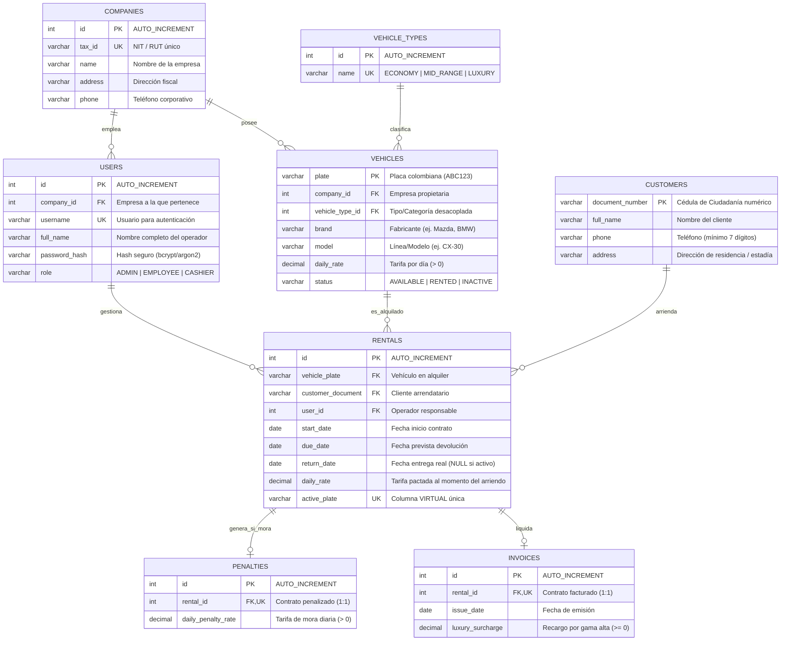

# Documento de Especificación y Diseño: Fase 4 (Base de Datos y Persistencia Relacional)
## Sistema de Gestión de Alquiler de Vehículos — Neiva Rent a Car

**Programa de Formación:** Tecnólogo en Análisis y Desarrollo de Software (ADSO) — SENA  
**Ficha:** 3239188 | **Sede:** Centro de la Industria, la Empresa y los Servicios (CIES) — Regional Huila  
**Instructor Evaluador:** Carlos Julio Cadena  
**Grupo:** Grupo 06  
**Integrantes:** Gabriel Tijaro Jiménez, Camilo Gaitán  
**Fecha:** Noviembre de 2026  
**Artefactos Técnicos Relacionados:**
* Script DDL/DML Ejecutable: `Fase 4/vehicle_rental.sql` (MySQL 8.0 / InnoDB / UTF-8 mb4)
* Documento de Requerimientos: `REQUERIMIENTOS DEL SISTEMA.pdf`
* Diagramas UML: `DIAGRAMAS UML ALQUILER VEHICULOS.pdf`
* Prototipo Interactivo: `Fase 5-Mockup/rent a car/index.html`

---

## 1. Introducción y Alcance de la Fase 4

El presente documento formaliza el diseño arquitectónico de la capa de persistencia relacional para el **Sistema de Gestión de Alquiler de Vehículos (Neiva Rent a Car)**. Este modelo supera la persistencia volátil en memoria desarrollada en la Fase 3, estableciendo un esquema robusto en **Tercera Forma Normal (3FN)** implementado en **MySQL 8.0 (motor InnoDB)**.

El diseño garantiza:
1. **Integridad Referencial Absoluta:** Protección en cascada y restricciones estrictas para evitar registros huérfanos.
2. **Blindaje de Reglas de Negocio en el Motor SQL:** Control de concurrencia mediante columnas virtuales generadas, validaciones por expresiones regulares (`REGEXP`) y políticas de baja lógica.
3. **Desacoplamiento y Escalabilidad:** Nomenclatura normalizada en inglés (tablas en plural y atributos en singular) con tablas maestras independientes.

---

## 2. Diagrama Entidad-Relación Físico (Mermaid ER)

El modelo relacional se compone de 8 tablas vinculadas formalmente mediante claves primarias (`PK`) y foráneas (`FK`), complementado con una vista analítica de liquidación:



---

## 3. Diccionario de Datos

### 3.1. Tabla `companies`
Almacena la sede o sucursal operativa de la empresa arrendadora.
* **`id`** (`INT`, PK, Auto-increment): Identificador único de la compañía.
* **`name`** (`VARCHAR(100)`, NOT NULL): Razón social de la empresa (*Neiva Rent a Car*).
* **`tax_id`** (`VARCHAR(20)`, NOT NULL, UNIQUE): Número de Identificación Tributaria (NIT) colombiano.
* **`address`** (`VARCHAR(150)`, NULL): Dirección de la sede principal en Neiva.
* **`phone`** (`VARCHAR(15)`, NULL): Teléfono corporativo de contacto.

### 3.2. Tabla `users`
Almacena las cuentas de usuario de los empleados con acceso al sistema operativo.
* **`id`** (`INT`, PK, Auto-increment): Identificador único del operador.
* **`company_id`** (`INT`, NOT NULL, FK `companies.id`): Sede en la que labora el usuario.
* **`full_name`** (`VARCHAR(100)`, NOT NULL): Nombre y apellidos completos del empleado.
* **`username`** (`VARCHAR(50)`, NOT NULL, UNIQUE): Identificador de acceso (*login*).
* **`password_hash`** (`VARCHAR(255)`, NOT NULL): Resumen criptográfico de la contraseña.
* **`role`** (`VARCHAR(20)`, NOT NULL): Rol asignado. Restricción `CHECK (role IN ('ADMIN', 'EMPLOYEE', 'CASHIER'))`.

### 3.3. Tabla `customers`
Contiene el directorio oficial de arrendatarios para expedición legal de contratos.
* **`document_number`** (`VARCHAR(15)`, PK): Cédula de Ciudadanía o extranjería. Restricción `CHECK (document_number REGEXP '^[0-9]+$')` garantizando entrada numérica estricta sin puntos ni caracteres especiales.
* **`full_name`** (`VARCHAR(100)`, NOT NULL): Nombre completo del arrendatario.
* **`phone`** (`VARCHAR(15)`, NOT NULL): Teléfono móvil de contacto. Restricción `CHECK (CHAR_LENGTH(phone) >= 7)`.
* **`address`** (`VARCHAR(150)`, NULL): Dirección de domicilio o residencia temporal en Huila.

### 3.4. Tabla `vehicle_types` *(Subsanación Hallazgo H-G06-04)*
Tabla maestra de categorización desacoplada de la flota para permitir escalabilidad sin alterar el DDL de vehículos.
* **`id`** (`INT`, PK, Auto-increment): Identificador de categoría.
* **`name`** (`VARCHAR(50)`, NOT NULL, UNIQUE): Nombre del segmento (`ECONOMY`, `MID_RANGE`, `LUXURY`).

### 3.5. Tabla `vehicles`
Inventario de la flota automotriz disponible y operativa.
* **`plate`** (`VARCHAR(10)`, PK): Placa oficial del automotor en formato colombiano.
* **`company_id`** (`INT`, NOT NULL, FK `companies.id`): Empresa propietaria del activo.
* **`vehicle_type_id`** (`INT`, NOT NULL, FK `vehicle_types.id`): Llave foránea hacia el tipo de vehículo.
* **`brand`** (`VARCHAR(50)`, NOT NULL): Fabricante de la unidad (ej. *Chevrolet*, *Mazda*, *BMW*).
* **`model`** (`VARCHAR(50)`, NOT NULL): Línea comercial (ej. *Spark*, *CX-30*, *Serie 4*).
* **`daily_rate`** (`DECIMAL(10,2)`, NOT NULL): Tarifa base diaria en Pesos Colombianos (COP). Restricción `CHECK (daily_rate > 0)`.
* **`status`** (`VARCHAR(20)`, NOT NULL, DEFAULT `'AVAILABLE'`): Estado de la unidad. Restricción `CHECK (status IN ('AVAILABLE', 'RENTED', 'INACTIVE'))`.

### 3.6. Tabla `rentals`
Registra las transacciones y contratos de alquiler celebrados entre clientes y la empresa.
* **`id`** (`INT`, PK, Auto-increment): Número de contrato oficial.
* **`start_date`** (`DATE`, NOT NULL): Fecha pactada de entrega del vehículo.
* **`due_date`** (`DATE`, NOT NULL): Fecha pactada límite para la devolución. Restricción `CHECK (DATEDIFF(due_date, start_date) >= 1)`.
* **`return_date`** (`DATE`, NULL): Fecha efectiva de retorno. Si el contrato está activo permanece en `NULL`. Restricción `CHECK (return_date IS NULL OR return_date >= start_date)`.
* **`daily_rate`** (`DECIMAL(10,2)`, NOT NULL): Tarifa diaria pactada al momento de la firma (histórico no mutable).
* **`user_id`** (`INT`, NOT NULL, FK `users.id`): Operador que expidió el contrato.
* **`vehicle_plate`** (`VARCHAR(10)`, NOT NULL, FK `vehicles.plate`): Unidad arrendada.
* **`customer_document`** (`VARCHAR(15)`, NOT NULL, FK `customers.document_number`): Arrendatario.
* **`active_plate`** (`VARCHAR(10)`, VIRTUAL GENERATED, UNIQUE): Columna calculada:
  ```sql
  active_plate VARCHAR(10) GENERATED ALWAYS AS (IF(return_date IS NULL, vehicle_plate, NULL)) VIRTUAL,
  CONSTRAINT uq_rentals_one_active_per_vehicle UNIQUE (active_plate)
  ```

### 3.7. Tabla `penalties`
Registra las penalizaciones liquidadas para contratos que incurrieron en días de mora.
* **`id`** (`INT`, PK, Auto-increment): Identificador de la penalidad.
* **`rental_id`** (`INT`, NOT NULL, UNIQUE, FK `rentals.id`): Relación 1 a 1 estricta con el contrato penalizado.
* **`daily_penalty_rate`** (`DECIMAL(10,2)`, NOT NULL): Valor diario de sanción. Restricción `CHECK (daily_penalty_rate > 0)`.

### 3.8. Tabla `invoices`
Liquidación financiera final y comprobante fiscal de la operación de alquiler.
* **`id`** (`INT`, PK, Auto-increment): Folio de factura.
* **`rental_id`** (`INT`, NOT NULL, UNIQUE, FK `rentals.id`): Relación 1 a 1 con el contrato liquidado.
* **`issue_date`** (`DATE`, NOT NULL): Fecha de corte y emisión de la factura.
* **`luxury_surcharge`** (`DECIMAL(10,2)`, NOT NULL, DEFAULT 0): Recargo polimórfico si la unidad arrendada pertenece al segmento `LUXURY`. Restricción `CHECK (luxury_surcharge >= 0)`.

---

## 4. Normalización Formal (1FN, 2FN, 3FN)

El diseño superó rigurosamente las tres etapas de normalización:

1. **Primera Forma Normal (1FN):**
   * Todos los atributos contienen valores atómicos indivisibles (se separaron marcas y modelos; no existen grupos repetitivos ni listas concatenadas dentro de una sola celda).
   * Cada tabla cuenta con una clave primaria formal identificadora (`PK`).

2. **Segunda Forma Normal (2FN):**
   * El esquema cumple 1FN y todos los atributos no clave dependen de manera completa de la clave primaria, eliminando dependencias funcionales parciales. En tablas con clave compuesta natural, cada columna describe la entidad completa.

3. **Tercera Forma Normal (3FN):**
   * El modelo no presenta dependencias transitivas (ningún atributo no clave depende de otro atributo no clave).
   * **Subsanación del Hallazgo H-G06-04:** Inicialmente, el tipo de vehículo se encontraba acoplado como una restricción estática `CHECK (category IN (...))` en la tabla de vehículos. Se normalizó creando la entidad independiente `vehicle_types`, permitiendo que la empresa incorpore dinámicamente nuevas gamas (ej. *SUV*, *Pick-Up*, *Híbrido*) sin alterar el DDL de la base de datos.
   * **Valores Calculados Fuera de Tablas:** Los importes totales, días de alquiler transcurridos y moras no se almacenan como columnas redundantes en las tablas físicas, sino que se calculan al vuelo mediante la vista analítica `v_invoice_totals`.

---

## 5. Implementación de Reglas de Negocio en Base de Datos

| Regla | Nombre | Mecanismo SQL Implementado | Justificación Técnica |
| :---: | :--- | :--- | :--- |
| **RN-01** | **Unicidad de Alquiler Activo** | `active_plate VIRTUAL` + `UNIQUE (active_plate)` | Garantiza a nivel de motor SQL que un vehículo nunca pueda registrar dos contratos con `return_date IS NULL` simultáneamente. Al devolverse la unidad, el campo virtual se vuelve `NULL`, liberando la restricción sin borrar el histórico. |
| **RN-02** | **Baja Lógica y Conservación de Auditoría** | `status IN ('AVAILABLE', 'RENTED', 'INACTIVE')` | Cuando una unidad se desincorpora de la flota (`HU-03`), pasa a estado `INACTIVE`. Esto evita un `DELETE` físico que violaría las claves foráneas históricas de contratos y facturas pasadas. |
| **RN-03** | **Integridad de Cédulas y Teléfonos** | `CHECK (document_number REGEXP '^[0-9]+$')` | Impide que se guarden identificaciones con letras o símbolos (`123-A`, `N/A`), asegurando compatibilidad con el sistema tributario colombiano. |
| **RN-04** | **Tarifación Mayor a Cero** | `CHECK (daily_rate > 0)` | Protege el modelo financiero de la empresa impidiendo el registro de tarifas cero o valores negativos por error de digitación. |
| **RN-05** | **Vigencia Temporal Válida** | `CHECK (DATEDIFF(due_date, start_date) >= 1)` | Obliga a que todo contrato cubra un mínimo de 24 horas (1 día completo de alquiler). |

---

## 6. Vista Analítica de Totales (`v_invoice_totals`)

Para la liquidación de facturación sin duplicación de datos derivados, se implementó la vista `v_invoice_totals`. Esta consolida el tiempo real de arriendo, el subtotal base, el sobrecargo de lujo polimórfico y el cálculo dinámico de penalizaciones:

```sql
CREATE VIEW v_invoice_totals AS
SELECT  i.id                                                        AS invoice_id,
        i.issue_date,
        r.id                                                        AS rental_id,
        r.customer_document,
        r.vehicle_plate,
        DATEDIFF(r.due_date, r.start_date)                          AS rental_days,
        DATEDIFF(r.due_date, r.start_date) * r.daily_rate           AS subtotal,
        i.luxury_surcharge,
        COALESCE(GREATEST(DATEDIFF(r.return_date, r.due_date), 0) * p.daily_penalty_rate, 0)
                                                                    AS penalty_total,
        DATEDIFF(r.due_date, r.start_date) * r.daily_rate
          + i.luxury_surcharge
          + COALESCE(GREATEST(DATEDIFF(r.return_date, r.due_date), 0) * p.daily_penalty_rate, 0)
                                                                    AS grand_total
FROM invoices i
JOIN rentals r        ON r.id = i.rental_id
LEFT JOIN penalties p ON p.rental_id = r.id;
```

---

## 7. Consultas de Verificación y Auditoría con `LIKE` (Trazabilidad RF / HU)

En cumplimiento estricto con los requerimientos funcionales de búsqueda predictiva y coincidencia parcial solicitados en la auditoría técnica, el script `vehicle_rental.sql` incorpora el siguiente bloque de verificación:

### Consulta 1: Búsqueda parcial de flota disponible por marca, modelo o placa (`RF-02`, `HU-02`)
Soporta los filtros interactivos del catálogo de flota:
```sql
SELECT v.plate,
       v.brand,
       v.model,
       vt.name AS vehicle_type,
       v.daily_rate,
       v.status
FROM vehicles v
JOIN vehicle_types vt ON v.vehicle_type_id = vt.id
WHERE v.status = 'AVAILABLE'
  AND (v.brand LIKE '%Mazda%' OR v.model LIKE '%Spark%' OR v.plate LIKE '%ABC%');
```

### Consulta 2: Búsqueda predictiva de clientes por nombre o cédula (`RF-03`, `HU-04`, `HU-05`)
Elimina la fricción operativa de memorizar documentos en la expedición de contratos:
```sql
SELECT document_number,
       full_name,
       phone,
       address
FROM customers
WHERE full_name LIKE '%Andrés%'
   OR document_number LIKE '%1075%';
```

### Consulta 3: Monitoreo de contratos vigentes y trazabilidad operativa (`RF-04`, `HU-06`)
```sql
SELECT r.id AS rental_id,
       r.start_date,
       r.due_date,
       r.return_date,
       v.plate,
       CONCAT(v.brand, ' ', v.model) AS vehicle,
       c.full_name AS customer_name,
       c.phone AS customer_phone,
       u.full_name AS operator_name
FROM rentals r
JOIN vehicles v    ON r.vehicle_plate = v.plate
JOIN customers c   ON r.customer_document = c.document_number
JOIN users u       ON r.user_id = u.id
WHERE r.return_date IS NULL;
```

### Consulta 4: Auditoría de liquidaciones, moras calculadas y recargos (`RF-06`, `RF-07`, `HU-09`, `HU-10`)
```sql
SELECT invoice_id,
       issue_date,
       rental_id,
       customer_document,
       vehicle_plate,
       rental_days,
       subtotal,
       luxury_surcharge,
       penalty_total,
       grand_total
FROM v_invoice_totals;
```

---

## 8. Trazabilidad: Requerimientos ↔ Clases Java ↔ Modelo Relacional

| Requerimiento Funcional | Historia de Usuario | Clase Java POO (Fase 3/6) | Tabla MySQL (Fase 4) | Rol en el Dominio |
| :--- | :--- | :--- | :--- | :--- |
| **RF-01: Gestión de Flota** | `HU-01`, `HU-03` | `Vehicle.java`, `LuxuryVehicle.java` | `vehicles`, `vehicle_types` | Registro de flota, tarifas base y bajas lógicas. |
| **RF-02: Consulta de Disponibilidad** | `HU-02` | `Company.java` | `vehicles` (`status = 'AVAILABLE'`) | Catálogo filtrable por tipo y marca. |
| **RF-03: Gestión de Clientes** | `HU-04`, `HU-05`, `HU-12` | `Customer.java` | `customers` | Directorio de arrendatarios y validación de contacto. |
| **RF-04: Registro de Alquiler** | `HU-06`, `HU-07` | `Rental.java` | `rentals` | Contrato de arriendo, días de vigencia y asociación. |
| **RF-05 / RF-06: Devoluciones y Mora**| `HU-08`, `HU-09` | `Rental.java` | `rentals`, `penalties` | Retorno efectivo, control de retraso y multas diarias. |
| **RF-07: Facturación Electrónica** | `HU-10` | `Company.java` | `invoices`, `v_invoice_totals` | Liquidación consolidada, recargos de lujo y moras. |
| **RF-00 / RNF-05: Autenticación** | `HU-00` *(En formalización)* | `Alquiler_autosv2.java` | `users`, `companies` | Control de sesiones y roles operativos. |
